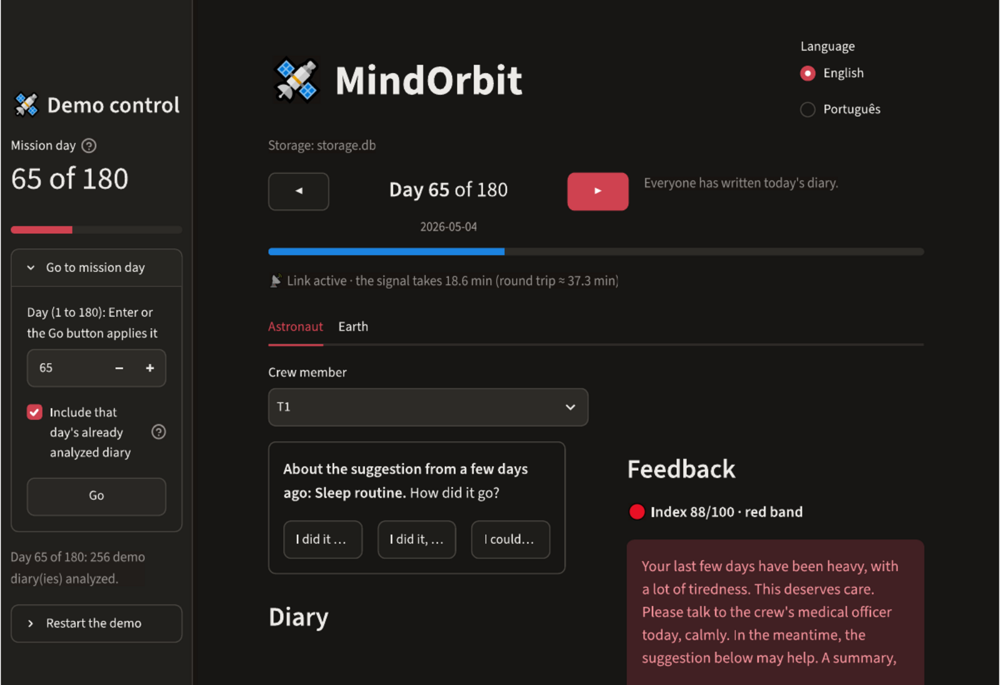
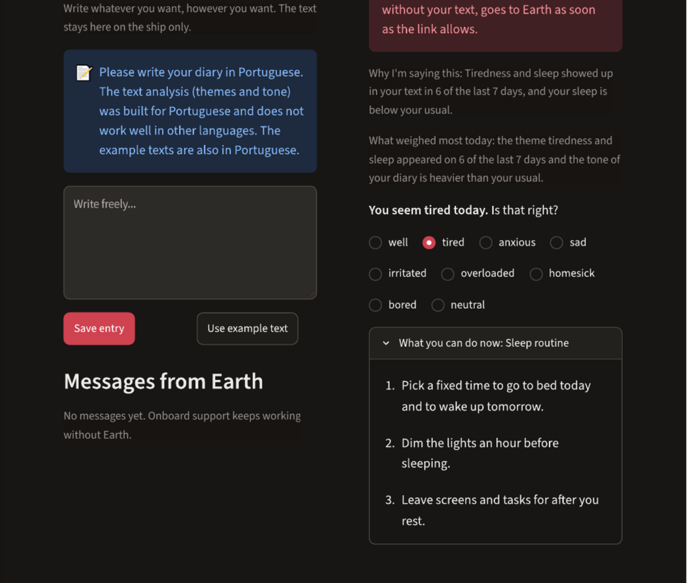
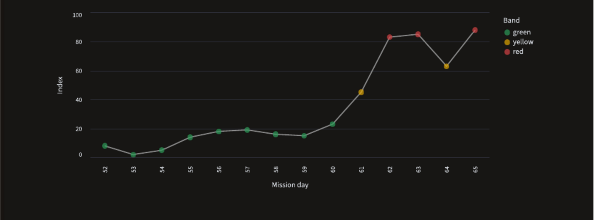
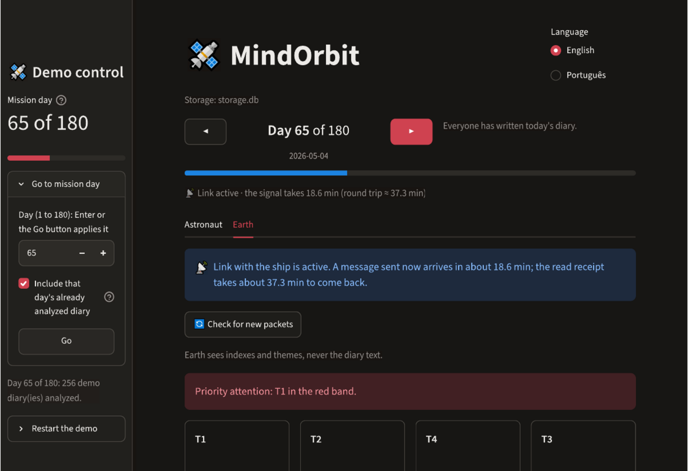
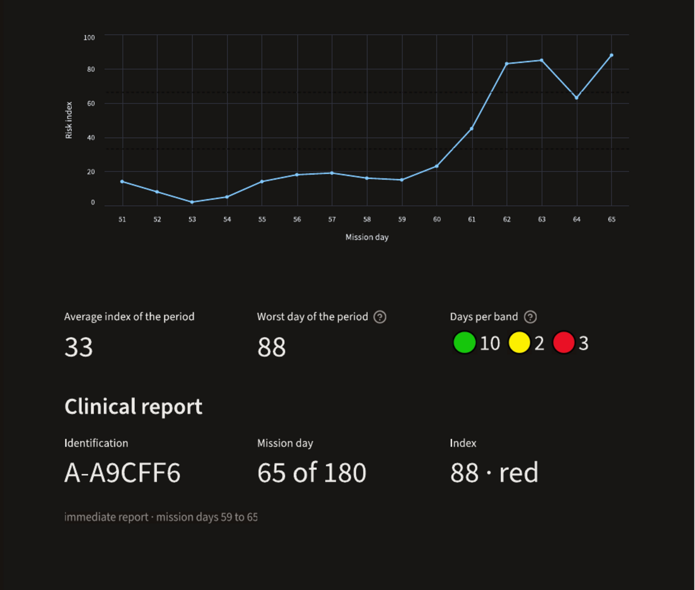
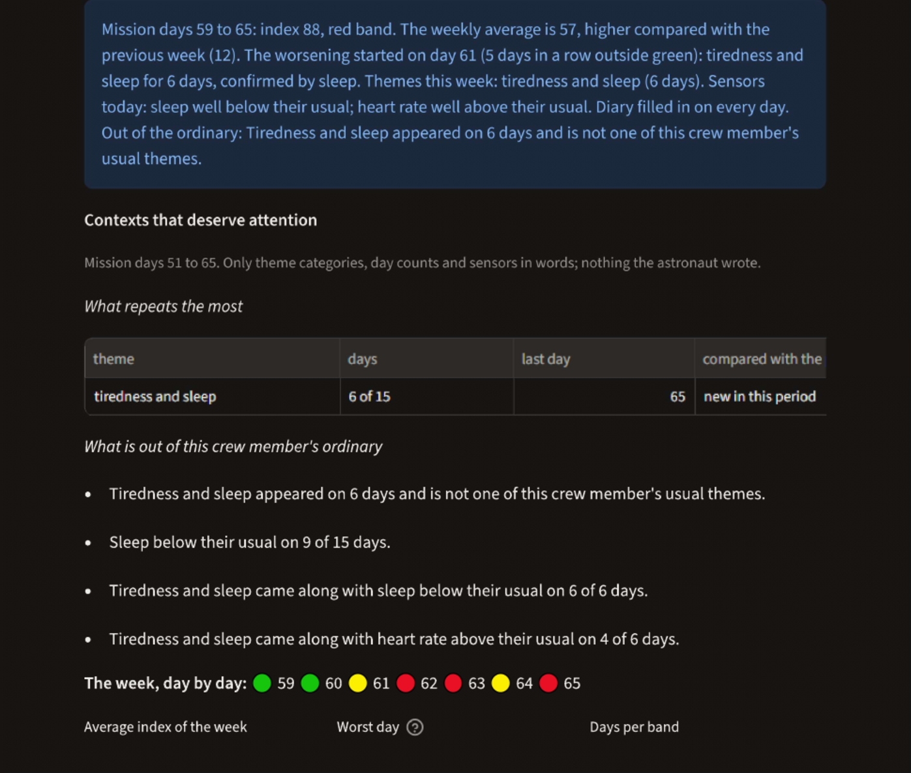
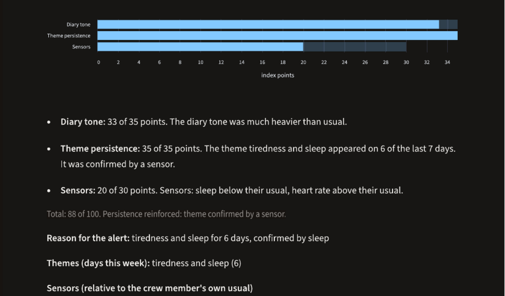
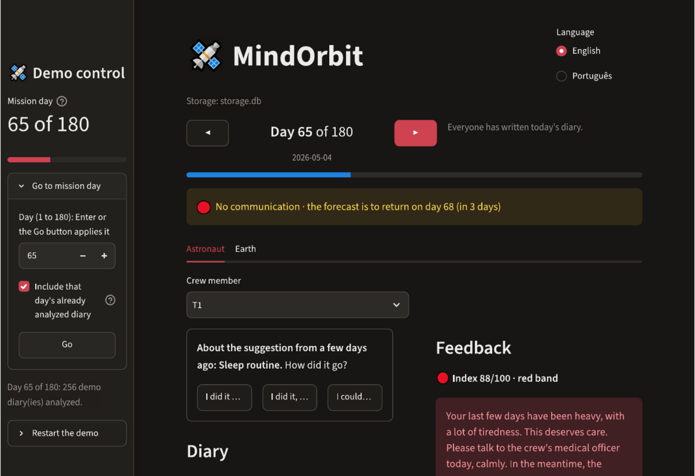

# MindOrbit

**Onboard mental-wellbeing support for astronauts on long missions, built on a private daily diary.**

NASA Space Apps Challenge 2026 · Challenge: [Create Health Monitoring Software for Astronauts on Space Missions](https://www.spaceappschallenge.org/2026/challenges/health-monitoring-software/) · Team **Elas**

### ▶ Try it now: **https://mindorbit.streamlit.app/**


No login, no install. The app opens in English (switch to Portuguese at the top). It may take a few seconds to wake up if nobody has used it recently.



---

## What MindOrbit is

On a mission to Mars, a message to Earth takes about 20 minutes each way, and there will be blackouts. Real-time psychological support from the ground will not exist, so support has to live **inside the spacecraft**.

MindOrbit runs on board. The astronaut writes a free-text diary entry. The software reads it together with sensor data (sleep, activity, resting heart rate), compares everything with **that astronaut's own baseline**, and answers right away with a warm, plain-language message and one concrete thing to do. It never waits for Earth.

Earth gets a short, encrypted report, never the diary text, and can send guidance back, which arrives after the real Earth–Mars signal delay.

> The sensors tell how the *body* is. The diary tells how the *person* is. MindOrbit analyzes the second signal on board, in the moment, and gives support back.

## Judge's guide: 3 minutes

1. **Open** https://mindorbit.streamlit.app/. Every visitor gets a private demo that starts at mission day 1 (reloading the page restarts it).
2. **Jump to the interesting part.** In the sidebar open **Go to mission day**, type **65**, click **Go**. Pick crew member **T1** in the **Astronaut** tab.
   You will see a **red band (index 88/100)**, a feedback message that says *why* ("tiredness and sleep showed up in your text in 6 of the last 7 days, and your sleep is below your usual"), guidance to talk to the crew's medical officer, a guided countermeasure, a mood the astronaut can confirm or correct, and a 14-day history.
3. **Switch to the Earth tab.** The health team sees a clinical report: summary, index breakdown in points, the week day by day, contexts that deserve attention, and what support was given on board. Use the **Period** selector (7 days to full history).
4. **Turn on Blackout** in the sidebar. Onboard support keeps working; reports wait in the queue and leave when the link returns.
5. **Send guidance from Earth** (bottom of the Earth tab). It reaches the astronaut after the signal delay (shortened to seconds in the demo), and the read receipt travels back to Earth.

> **Language note.** The interface is bilingual, but the text analysis (themes, tone, negation) was built for **Portuguese**. To test the diary, write in Portuguese or use the **Use example text** button. The app shows a notice about this.

## Screens

| Astronaut: feedback, reason, mood and guided countermeasure | Astronaut: personal history (14 days) |
| --- | --- |
|  |  |

| Earth: crew overview and priority alert | Earth: clinical report |
| --- | --- |
|  |  |

| Earth: contexts that deserve attention | Earth: index breakdown |
| --- | --- |
|  |  |

| Blackout: Earth link down, onboard support keeps working |
| --- |
|  |

## What it does

1. **Diary (astronaut tab).** One free-text field. No fixed questions, no minimum length.
2. **Analysis.** Themes (tiredness and sleep, anxiety, low mood, homesickness, crew conflict, overload, monotony), tone with a negation rule, persistence over a 7-day window, cross-checking with sensors, and distance from the astronaut's **own** baseline (z-scores).
3. **Risk index (0–100).** 35% diary tone, 35% persistent negative themes, 30% sensors. Bands: green 0–33, yellow 34–66, red 67–100.
4. **Immediate support.** A message that names its reason, a guided countermeasure with a timer when it fits, a daily mood label to confirm or correct, a 14-day history, and, in red, guidance to see the crew medical officer.
5. **Report to Earth.** Weekly (days 7, 14, 21…) and immediate when the index *enters* red. Pseudonymized, compressed, encrypted (Fernet) and checksummed (SHA-256). No diary text and no raw sensor values. The astronaut only sees a notice that a report was sent.
6. **Earth tab.** Clinical report with plain-language summary, index breakdown in points, week in perspective, recurring contexts and what is out of the astronaut's ordinary, selectable periods, and a form to send guidance back.
7. **Simulated link.** Signal delay (real Earth–Mars light delay from NASA/JPL orbital elements, or a manual slider), blackouts with an optional expected return, a message queue and read receipts that travel back with the delay.

```
                        SPACECRAFT (onboard)
 Sensors (CSV) ─────►  Ingest ─► Analysis core ─► Support ─► Astronaut UI
 Baseline (per crew)►          (themes, tone,    (feedback,
 Diary (UI) ───────►            z-scores,         countermeasure,
                                persistence,      mood, history,
                                cross-check,      escalation)
                                index)
                                     │
                                     ▼
                  Report ─► pseudonym → JSON → zlib → Fernet → SHA-256
                                     │
                       SIMULATED LINK (queue with delay + blackout)
                                     │
                  EARTH: unpack ─► clinical report ─► guidance ─► back through the queue
```

The onboard flow never calls the link: with the link down, support keeps working.

---

## NASA data and sources

MindOrbit is built on NASA material in two different ways. We list them separately so it is clear what is inside the software and what shaped the idea.

### A. NASA data used inside the software

| Source | What the software uses it for |
| --- | --- |
| [Approximate Positions of the Planets, NASA JPL Solar System Dynamics](https://ssd.jpl.nasa.gov/planets/approx_pos.html) (Table 1: Keplerian elements and rates for Earth and Mars) | `simulator/light_delay.py` computes, for each mission day, the Earth and Mars positions, the distance between them and the one-way light time. The result (`data/atraso_terra_marte.csv`, about 19.5 min on day 1 and 18.6 min on day 65) drives the delay of the Earth link, the "signal takes X min" notices and the timing of reports, guidance and read receipts. |

### B. NASA sources used to design the solution

| Source | What it contributed to the project |
| --- | --- |
| [Risk of Behavioral Changes and Psychiatric Disorders, NASA](https://www.nasa.gov/reference/risk-of-behavioral-changes-and-psychiatric-disorders/) | Defined the problem: prolonged isolation and confinement as drivers of behavioral risk, with effects on sleep, morale and decision-making. It guided the themes the system tracks (tiredness and sleep, anxiety, low mood, isolation, crew conflict, overload) and the sensors used (sleep, activity, heart rate). |
| [Evidence Report 2025, NTRS 20250001454](https://ntrs.nasa.gov/citations/20250001454) and [Evidence Report 2016, NTRS 20160004365](https://ntrs.nasa.gov/citations/20160004365) | Showed that risk is relatively low on today's missions of up to six months and grows with mission length. This is why we simulate a 180-day mission and look at how things change over time instead of single days. |
| [Medical Capability Gaps and Roadmap, AsMA 2023, NTRS](https://ntrs.nasa.gov/api/citations/20230007411/downloads/AsMA%202023%20Medical%20Capability%20Gaps%20and%20Roadmap.pdf) | Lists semi-autonomous tools for behavioral health diagnosis, treatment and support as a capability gap for exploration. This is the gap MindOrbit addresses and the core of our justification. |
| [Overview of NASA Behavioral Health and Performance Standard Measures, NTRS 20190000670](https://ntrs.nasa.gov/citations/20190000670) | Background on how NASA measures behavioral health and performance, used to choose what to track and what to leave for later. |
| [Reaction Self Test study on the ISS, PMC](https://pmc.ncbi.nlm.nih.gov/articles/PMC8919197) | Background on a brief attention test used on the ISS. It is the reference for our planned future feature: a short attention test integrated with the diary. |
| [Behavioral health investigations in the one-year mission, Phys.org (2015)](https://phys.org/news/2015-06-dont-stress-small-nasa-one-year.pdf) | Background on behavioral health research during a one-year mission, which informed how we think about long-duration isolation. |

The last three entries are background research related to NASA's work (two of them are not hosted by NASA), not data read by the software.

The crew data (sensors, baselines and diaries) is **simulated**, because real astronaut data is not public. Details in [docs/data-and-sources.md](docs/data-and-sources.md).

## How AI was used in this project

We used AI tools as support to speed up the writing and review of the project, both at the code level and in the texts. They helped us refine the scope and architecture, write and review Python code and tests, draft the documentation, and translate the interface and documents into English. The product decisions were ours: the problem we chose, the features, the privacy rules (the diary text never leaves the spacecraft) and the design of the risk index. We also reviewed, ran and tested the result.

---

## Run it yourself

Requires Python 3.11+.

```bash
pip install -r requirements.txt
streamlit run app.py
```

Run the tests with `python -m pytest -q`.

> This repository holds the code and the documentation. The hosted app at https://mindorbit.streamlit.app/ runs this same code. See [docs/deployment.md](docs/deployment.md).

## Privacy by design

- The diary text and raw sensor values never leave the spacecraft. The report is built only from analysis results, and an automated test inspects the decrypted packet.
- Earth sees a pseudonym (`A-XXXXXX`), mission days (never calendar dates), sensors described in words, and theme categories with day counts.
- The "contexts" section uses only the theme catalog, counts and sensor levels, so an out-of-the-ordinary occurrence can be reported without exposing what was written.

## Known limits

- **Simulated crew data.** The sensors, baselines and 720 diary entries (4 crew members × 180 days) come from a simulator with a fixed random seed, with three planted "wear-down" episodes.
- **Prototype assumptions.** Index weights, band limits and the 4-day alert threshold are assumptions of the prototype.
- **The text analysis is in Portuguese.** The word lists and the demo diaries are Portuguese. A local language model is the planned evolution.
- **A word-list approach does not understand irony or context**, so some themes can be flagged wrongly.
- **Support, not diagnosis.** It does not replace the medical officer or the psychologist; in red it sends the astronaut to the medical officer.
- **Pseudonyms are weak with only 4 crew members.** The promise is that the text and raw data stay on board.
- **The Fernet key is a shared file** (a simulation). In a real mission it would be distributed before launch.
- **The baseline is created on Earth.** Normal in flight can differ (for example, sleep). Adjusting it during the mission is future work.

## Documentation

| Document | What it covers |
| --- | --- |
| [docs/mvp-scope.md](docs/mvp-scope.md) | Problem, scope, 20 functional and 10 non-functional requirements, what is out of the MVP |
| [docs/architecture.md](docs/architecture.md) | Principles, modules, flows, data model, decisions |
| [docs/report-definition.md](docs/report-definition.md) | Who sees what, the report contract (v5), sending rules |
| [docs/data-and-sources.md](docs/data-and-sources.md) | Simulated data, the NASA/JPL light-delay computation, sources |
| [docs/deployment.md](docs/deployment.md) | Running locally and hosting on Streamlit Community Cloud |

## Team Elas

| Name | Role | Contact |
| --- | --- | --- |
| **Andreza Costa dos Santos** | Analysis core, support and feedback, report, astronaut and Earth interfaces, integration | dehcosta.475@gmail.com |
| **Aicha Nacambo** | Simulated data, Earth–Mars light delay, database, communication link and packaging | nacamboaicha4@gmail.com |

## License

[MIT](LICENSE). MindOrbit is a project made for the NASA Space Apps Challenge. It is not affiliated with or endorsed by NASA.
